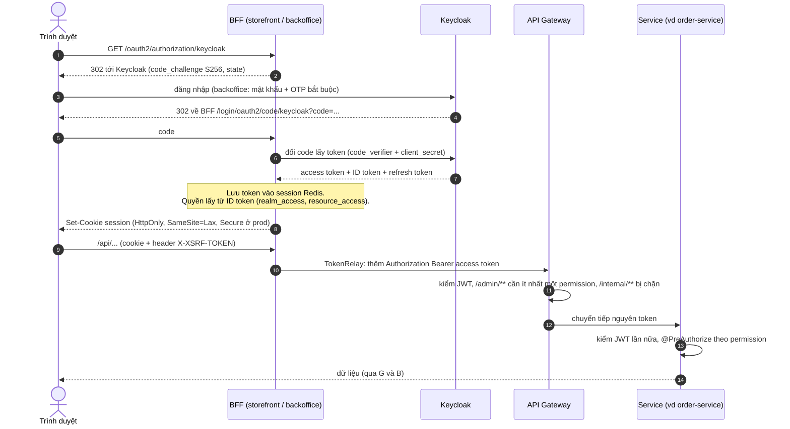
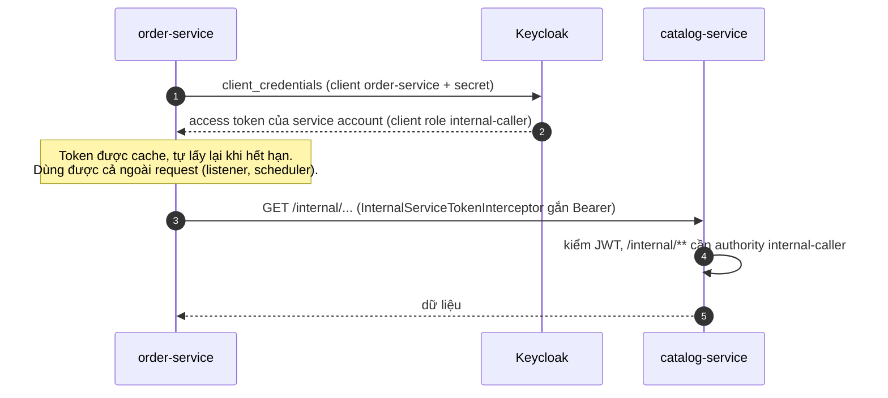
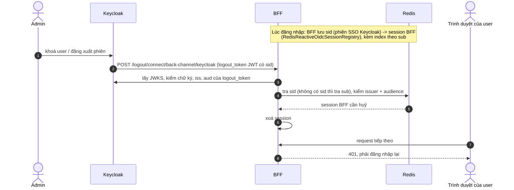
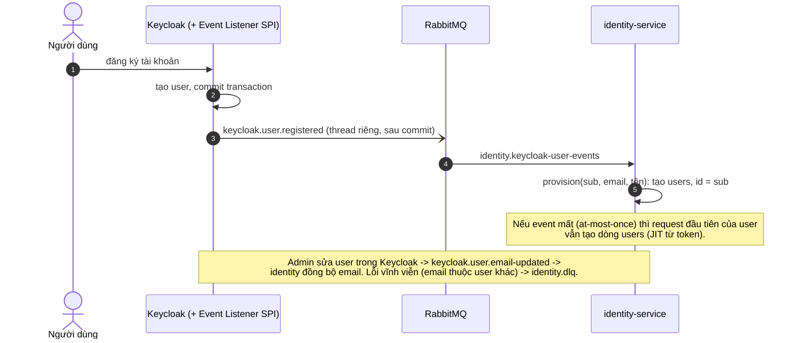

# Luồng xác thực (Keycloak)

Tài liệu ôn tập: bốn luồng và bảng claim. Chi tiết cấu hình realm, vận hành và production: [`platform/keycloak/README.md`](../platform/keycloak/README.md).
Quy tắc bảo mật cho code: [`.claude/rules/security.md`](../.claude/rules/security.md).

Ý chính:

- **Keycloak là nơi duy nhất cấp token.** Trình duyệt không bao giờ cầm token: BFF giữ token trong session (Redis), trình duyệt chỉ có cookie session `HttpOnly`.
- **Mỗi hop tự kiểm tra lại JWT** (chữ ký bằng JWKS, `iss`, `aud=fashion-api`). Gateway chuyển tiếp token nguyên vẹn, service không tin gateway.
- Phân quyền = role trong token: `realm_access.roles` thành `ROLE_*`, `resource_access.fashion-api.roles` thành permission (`order:read`, `group:manage`…).

## 1. Đăng nhập qua BFF (Authorization Code + PKCE)

- PKCE bật cho cả client bí mật (realm bắt buộc `S256`); không có direct grant, không có implicit.
- CSRF: BFF ghi cookie XSRF (tên riêng mỗi BFF vì cookie không phân biệt cổng); SPA gửi lại giá trị qua header.
- Access token sống 5 phút, refresh token xoay vòng (dùng lại token cũ thì cả phiên bị huỷ).

## 2. Service gọi service (`client_credentials`)

- Gateway chặn hẳn `/internal/**` từ ngoài; chỉ service nội bộ gọi nhau trực tiếp.
- Token user (kể cả admin) gọi `/internal/**` bị 403; token service account không có realm role nên không vào được API của user.
- Interceptor chỉ gắn cho Feign client nội bộ, không gắn cho client ra ngoài (GHN, payOS). Lấy token thất bại là sự cố hạ tầng: 502, không phải 500.

## 3. Back-channel logout (admin khoá tài khoản, đăng xuất ở nơi khác)

- Registry nằm trong Redis nên còn nguyên sau khi BFF restart và dùng chung giữa nhiều instance. Bản in-memory trước đây mất bảng này, user bị khoá vẫn dùng tiếp tới khi session hết hạn.
- Token giả mạo (ký bằng khoá khác) bị 400 và không xoá session nào.

## 4. Keycloak báo hệ thống: tạo user và đổi email

## Bảng claim: claim nào dùng ở đâu

| Claim | Nguồn | Dùng để |
|---|---|---|
| `iss` | Keycloak (URL browser thấy, `KC_HOSTNAME`) | Mọi resource server kiểm `issuer`; JWKS lấy qua đường nội bộ nên `issuer-uri` và `jwk-set-uri` cấu hình riêng |
| `aud` = `fashion-api` | mapper `fashion-api-audience` ở mọi client | Resource server từ chối token cấp cho đối tượng khác |
| `sub` | Keycloak | = `users.id` của identity; khoá để service khác tham chiếu user |
| `email`, `email_verified`, `name` | scope `email` / `profile` | JIT provisioning tạo dòng `users`; service account không có `email` nên không bao giờ thành user |
| `realm_access.roles` | realm role | `ROLE_USER`, `ROLE_ADMIN` (`KeycloakJwtAuthoritiesConverter`) |
| `resource_access.fashion-api.roles` | client role, kể cả role từ group | Permission (`order:read`, `group:manage`…) cho `@PreAuthorize` và gateway; `internal-caller` cho `/internal/**` |
| `sid` | Keycloak (phiên SSO) | Khoá của registry back-channel logout |
| `exp` (5 phút) | Keycloak | Access token hết hạn nhanh; resource server từ chối token quá hạn |

## Thử lại các luồng này

| Muốn xem | Cách |
|---|---|
| Nội dung token | Lấy token (Swagger UI Authorize, hoặc `client_credentials` của service account) rồi giải mã ở jwt.io, đối chiếu bảng trên |
| Luồng 2 và kiểm tra `iss`/`aud`/chữ ký | `KeycloakRealmIntegrationTest` (identity-service): dùng Keycloak thật qua Testcontainers |
| Luồng 3 | `RedisReactiveOidcSessionRegistryRedisIntegrationTest` (common-library) và `*BackChannelLogoutTest` (hai BFF) |
| Luồng 4 | `docker compose up -d --build keycloak rabbitmq identity-service`, đăng ký user, xem bảng `users` |
| Event / lịch sử đăng nhập | Admin console của Keycloak, mục Events (đã bật, giữ 30 ngày) |
